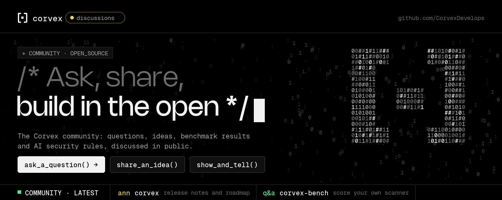

  

  <a href="https://github.com/CorvexDevelops/discussions/discussions"><b>open_discussions()</b></a>
  &nbsp;·&nbsp;
  <a href="https://corvexdevelops.github.io/index.html">corvex</a>
  &nbsp;·&nbsp;
  <a href="https://corvexdevelops.github.io/updates.html">updates</a>
  &nbsp;·&nbsp;
  <a href="https://corvexdevelops.github.io/legal/security.html">security policy</a>
  &nbsp;·&nbsp;
  <a href="#italiano">italiano</a>

---

## `/* The Corvex community */`

This is the public meeting point of Corvex, the team of agents that puts your dashboards, software and computer to the test.

Ask questions, propose ideas, share your benchmark results and your security rules for AI agents, and follow what we are building.

Everything happens in the [Discussions](https://github.com/CorvexDevelops/discussions/discussions) tab of this repository.

## `+ CATEGORIES`

| category | what goes there |
|---|---|
| `announcements()` | Releases, roadmap and news from the Corvex team, the same you find in News & Updates. Only the team opens new threads, everyone can reply. |
| `q_and_a()` | Questions on Corvex, corvexai, the agents, reports and badges. Mark the answer that solved your problem. |
| `ideas()` | Features you would like, new agents, integrations. The most voted ideas are the first we look at. |
| `show_and_tell()` | Your corvex-bench scores, your rules, how you use Corvex in your pipeline. |
| `general()` | Everything else about application security and defending what you build. |

## `{} OPEN_SOURCE`

Three projects are free to use, under the Apache 2.0 licence, and questions about them are welcome here too.

| project | what it is |
|---|---|
| [corvex-bench](https://github.com/CorvexDevelops/corvex-bench) | A website, a project and a network capture with 71 known flaws, each with a clean twin. It scores any tool in SARIF or JSON. |
| [corvex-netkit](https://github.com/CorvexDevelops/corvex-netkit) | Network capture readers, known-vulnerability matching and network lists, written from public specifications. |
| [ai-security-rules](https://github.com/CorvexDevelops/ai-security-rules) | Security rules for AI coding agents: CLAUDE.md, AGENTS.md, Cursor, Copilot and Windsurf. |

## `! BEFORE_YOU_POST`

- **Never publish a vulnerability here.**
  Flaws in Corvex or in the open source projects are reported privately, following the [security policy](https://corvexdevelops.github.io/legal/security.html).
  We reply within three working days and, if you like, we thank you publicly.
- **Never paste secrets.**
  Remove keys, tokens, passwords, internal addresses and customer data from logs and screenshots.
- **Only what is yours.**
  Talk about platforms you own or are allowed to test in writing, never about someone else's systems.
- **Search first.**
  Your question may already have an answer.
- **Be kind and concrete.**
  Version, operating system and the steps to reproduce make every answer faster.

English and Italian are both welcome.

---

## `/* La community di Corvex */`

Questo è il punto d'incontro pubblico di Corvex, la squadra di agenti che mette alla prova le tue dashboard, i tuoi software e il computer su cui lavori.

Fai domande, proponi idee, condividi i risultati del benchmark e le tue regole di sicurezza per gli agenti AI, e segui quello che stiamo costruendo.

Tutto si svolge nella scheda [Discussions](https://github.com/CorvexDevelops/discussions/discussions) di questo repository.

| categoria | cosa ci va |
|---|---|
| `announcements()` | Versioni, roadmap e novità del team Corvex, le stesse di News & Updates. Solo il team apre nuove discussioni, tutti possono rispondere. |
| `q_and_a()` | Domande su Corvex, corvexai, agenti, report e badge. Segna la risposta che ha risolto il tuo problema. |
| `ideas()` | Funzioni che vorresti, nuovi agenti, integrazioni. Le idee più votate sono le prime che valutiamo. |
| `show_and_tell()` | I tuoi punteggi su corvex-bench, le tue regole, come usi Corvex nella tua pipeline. |
| `general()` | Tutto il resto sulla sicurezza delle applicazioni e sulla difesa di quello che costruisci. |

**Prima di scrivere**

- **Mai pubblicare una vulnerabilità qui.**
  Le falle di Corvex o dei progetti open source si segnalano in privato, seguendo la [politica di sicurezza](https://corvexdevelops.github.io/legal/security.html).
  Rispondiamo entro tre giorni lavorativi e, se vuoi, ti ringraziamo pubblicamente.
- **Mai incollare segreti.**
  Togli chiavi, token, password, indirizzi interni e dati dei clienti da log e screenshot.
- **Solo ciò che è tuo.**
  Parla di piattaforme tue o che hai il permesso scritto di testare, mai dei sistemi di altri.
- **Cerca prima.**
  La tua domanda potrebbe avere già una risposta.
- **Sii gentile e concreto.**
  Versione, sistema operativo e passi per riprodurre il problema rendono ogni risposta più veloce.

---

  corvex · <a href="https://github.com/CorvexDevelops">github.com/CorvexDevelops</a>

